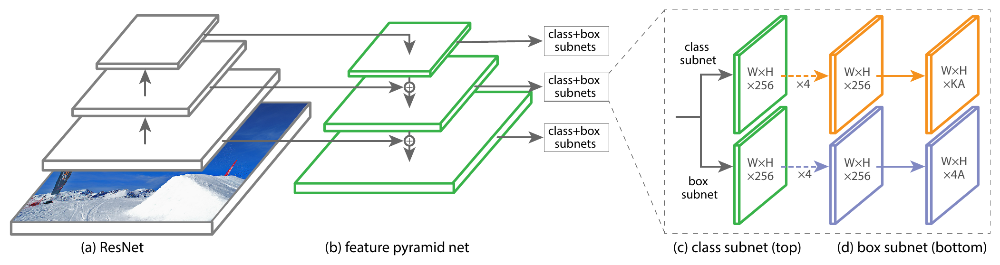

# RetinaNet from scratch

A full re-implementation of **RetinaNet** ([Lin et al., *Focal Loss for Dense Object Detection*, ICCV 2017](https://arxiv.org/abs/1708.02002)) in plain PyTorch.
No detection library: backbone, feature pyramid, anchors, matching, focal loss, box coding, NMS and mAP are all written here.

<p align="center">
  
</p>

<p align="center"><sub>Figure 3 from <a href="https://arxiv.org/abs/1708.02002">Lin et al., ICCV 2017</a>. A ResNet backbone (a), a feature pyramid on top (b), and two subnets shared across levels for classification (c) and box regression (d).</sub></p>

## The idea

Dense one-stage detectors evaluate ~100k anchors per image. Almost all of them are easy background.
With plain cross-entropy those easy negatives dominate the loss and training stalls.
RetinaNet fixes this with the **focal loss**, which scales down well-classified examples:

$$
\mathrm{FL}(p_t) = -\,\alpha_t\,(1 - p_t)^{\gamma}\,\log(p_t),
\qquad
p_t = \begin{cases} p & \text{if } y = 1 \\ 1 - p & \text{otherwise} \end{cases}
$$

With $\gamma = 2$ an example classified at $p_t = 0.9$ gets a loss 100× smaller than with cross-entropy.
The total loss is normalised by the number of positive anchors.

## What is implemented

| Part | File | Details |
|---|---|---|
| Backbone | `retinanet/backbone.py` | ResNet-18/34/50/101 (BasicBlock / Bottleneck), returns C3, C4, C5. Layer names match torchvision so ImageNet weights can be loaded. |
| FPN | `retinanet/model.py` | Lateral 1×1 convs, top-down 2× upsampling with residual sums, 3×3 output convs. P6 = 3×3 s2 conv on C5, P7 = 3×3 s2 conv on ReLU(P6). |
| Heads | `retinanet/model.py` | Class and box subnets: 4 × (3×3 conv, 256, ReLU) then a K·A or 4·A output conv. Shared across levels. |
| Anchors | `retinanet/anchors.py` | Sizes 32 to 512 on P3 to P7, 3 scales {2⁰, 2^⅓, 2^⅔} × 3 ratios {1:2, 1:1, 2:1} = 9 per location. |
| Matching | `retinanet/losses.py` | IoU ≥ 0.5 positive, < 0.4 background, in between ignored. Each ground truth also keeps its best anchor. |
| Losses | `retinanet/losses.py` | Sigmoid focal loss (α = 0.25, γ = 2) and smooth L1 on (dx, dy, dw, dh) normalised by (0.1, 0.1, 0.2, 0.2). |
| Init | `retinanet/model.py` | Last class conv bias set to −log((1 − π)/π) with π = 0.01, so training starts stable. |
| Inference | `retinanet/model.py`, `box_ops.py` | Top 1000 per level, score > 0.05, box decoding, class-aware NMS at 0.5, 100 detections max. |
| Evaluation | `retinanet/metrics.py` | VOC mAP@0.5, all-point interpolated AP. |
| Data | `retinanet/data.py` | Pascal VOC, resize (shorter side 512), horizontal flip, padding to a multiple of 128. |

## Usage

```bash
pip install -r requirements.txt

# unit tests (box coding, IoU, NMS, anchors, matching, focal loss, forward / backward)
python -m pytest -q tests

# end-to-end check on synthetic shapes, runs on CPU in a few minutes
python sanity_check.py

# train on Pascal VOC 2007 (downloads the dataset the first time)
python train.py --data ./data --download --depth resnet50 --pretrained --epochs 24

# evaluate a checkpoint on VOC 2007 test
python evaluate.py --data ./data --ckpt checkpoints/retinanet_resnet50_ep23.pt
```

`sanity_check.py` trains a ResNet-18 RetinaNet on random images with squares and discs. It goes from 0 to above 0.9 mAP@0.5 in 400 steps on CPU, which checks that matching, losses, decoding and NMS fit together.

Training uses SGD (momentum 0.9, weight decay 1e-4), linear warmup then cosine decay, gradient clipping and mixed precision on GPU.

## Structure

```
retinanet/
  backbone.py   ResNet
  model.py      FPN, heads, RetinaNet, post-processing
  anchors.py    anchor generation
  losses.py     matching, focal loss, box loss
  box_ops.py    IoU, box encoding / decoding, NMS
  data.py       Pascal VOC + transforms
  metrics.py    mAP
train.py  evaluate.py  sanity_check.py  tests/
```

## References

```bibtex
@inproceedings{lin2017focal,
  title     = {Focal Loss for Dense Object Detection},
  author    = {Lin, Tsung-Yi and Goyal, Priya and Girshick, Ross and He, Kaiming and Doll{\'a}r, Piotr},
  booktitle = {ICCV},
  year      = {2017}
}
@inproceedings{lin2017fpn,
  title     = {Feature Pyramid Networks for Object Detection},
  author    = {Lin, Tsung-Yi and Doll{\'a}r, Piotr and Girshick, Ross and He, Kaiming and Hariharan, Bharath and Belongie, Serge},
  booktitle = {CVPR},
  year      = {2017}
}
@inproceedings{he2016resnet,
  title     = {Deep Residual Learning for Image Recognition},
  author    = {He, Kaiming and Zhang, Xiangyu and Ren, Shaoqing and Sun, Jian},
  booktitle = {CVPR},
  year      = {2016}
}
```

Project done during my exchange at Hanyang University (Seoul), supervised by Prof. Sungyong Baik.
